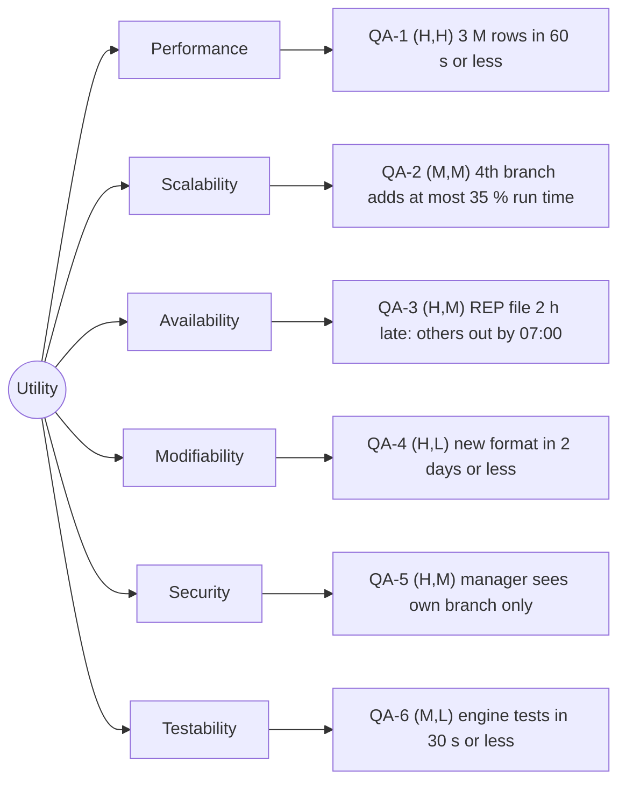

# Quality-attribute scenarios: Angkor Mart monthly sales report

## Stakeholders
- Head-office analyst: views and exports all branch and chain reports.
- Branch manager (PNH, REP, BTB): sees the report of their own branch only.
- Finance director: receives an e-mail when a report is ready.
- Operations person: runs and monitors the monthly job, handles late files.
- Development team (me): must change, test and extend the system quickly.

## Scenarios
| ID | Attribute | Source | Stimulus | Artifact | Environment | Response | Response measure | Rank |
|----|-----------|--------|----------|----------|-------------|----------|------------------|------|
| QA-1 | Performance | Scheduler, 06:00 on day 2 of M+1 | Starts the report for a month of about 3 M rows | Report engine | Normal operation, 8-core server, all files present | Report files written, "ready" event published | <= 60 s wall-clock, median of 5 runs after 2 warm-up runs | (H,H) |
| QA-2 | Scalability | Chain management | Opens a 4th branch with the same volume (33 000 rows/day) | Ingest and report engine | Normal operation | Report still produced with no code change | Run time grows <= 35 % vs 3 branches (median of 5 runs); 0 Java lines changed | (M,M) |
| QA-3 | Availability | REP branch internet link | REP's file for one day arrives 2 h late | Ingest job and report batch | Report day, link failure | PNH and BTB published on time, marked "partial"; REP merged and report regenerated on arrival | Partial report out by 07:00 in 20 of 20 simulated runs; full report regenerated <= 5 min after the late file arrives | (H,M) |
| QA-4 | Modifiability | Head office | Asks for a new export format | render package | Development time | New renderer added, other packages untouched | <= 2 person-days; <= 1 new class + 1 changed line (factory); 0 lines changed in ingest and model | (H,L) |
| QA-5 | Security | Branch manager of REP | Requests the PNH report | Web report page | Normal operation | Request denied and logged | 0 of 100 crafted requests return PNH data; 100 % of denials logged (checked by an automated test) | (H,M) |
| QA-6 | Testability | Developer | Runs the engine unit tests | Engine package | Laptop, no network, no real files | Tests run against in-memory data | Whole engine test suite <= 30 s; >= 80 % line coverage (measured with JaCoCo) | (M,L) |

## Rank justifications
- QA-1 (H,H): the report is due on the morning of day 2, and 3 M rows with BigDecimal arithmetic must be parsed and aggregated, so a poor design misses the deadline.
- QA-2 (M,M): a 4th branch is plausible but not planned, and it needs a design that parallelises by file.
- QA-3 (H,M): links fail "now and then" and the deadline is fixed, so we need an explicit partial-report policy.
- QA-4 (H,L): PDF, XLSX and web output are all planned, and the Strategy pattern makes each one cheap.
- QA-5 (H,M): managers must never see another branch's data, which needs authentication and per-branch authorization.
- QA-6 (M,L): the engine works on plain records, so tests are fast and simple.

## Assumptions
- A1: the report server has 8 cores and an SSD (to confirm with the client).
- A2: "late" means at most 2 h after 23:00; a later file counts as missing for that run.
- A3: a new branch has the same daily volume as the existing ones.
- A4: "100 crafted requests" means an automated test with 100 URL and parameter variations.
- A5: coverage is measured on the engine package only.

## Utility tree

## Architectural drivers
QA-1, QA-3, QA-5 (the (H,H) and (H,M) leaves).